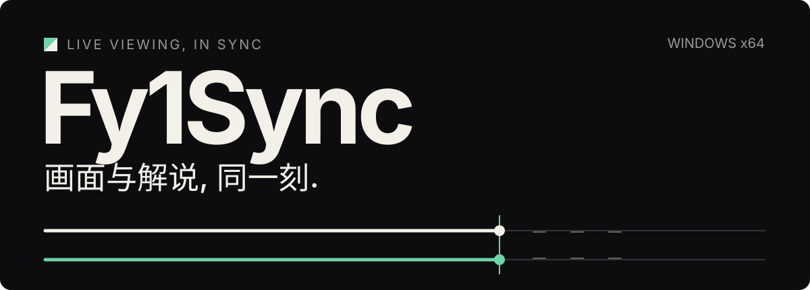
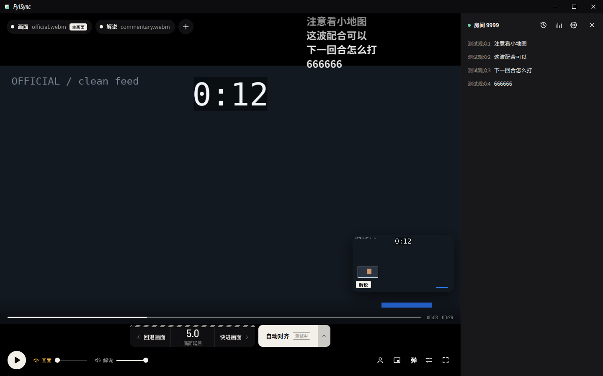
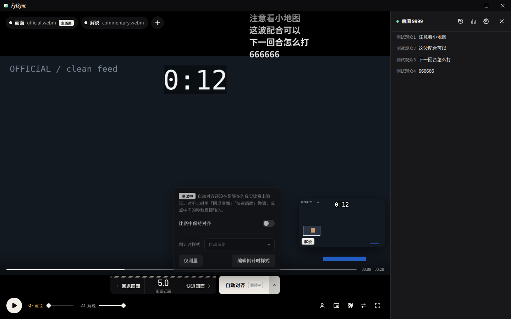
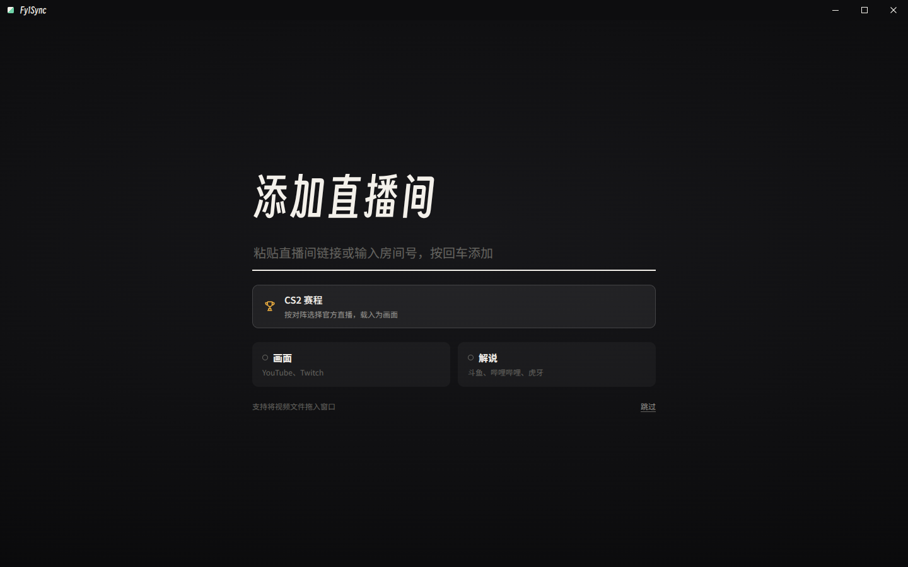

<p align="center">
  
</p>

# Fy1Sync

**看官方赛事画面, 听喜欢的主播解说, 让弹幕跟上正在发生的这一刻.**

Fy1Sync 是一款 Windows 桌面播放器. 将两路直播或录像放进同一个窗口, 分别选择画面和声音, 再通过延后较快的一路把它们对齐. 主要观赛场景是 CS2, 也可以手动组合其他内容的片源.

[下载安装](#下载安装) · [开始观看](#开始观看) · [接入范围](#接入范围) · [使用边界](#使用边界) · [从源码运行](#从源码运行)

<p align="center">
  
</p>

*界面截图使用当前代码渲染, 片源与弹幕均为离线测试数据, 不代表真实赛事或自动对齐效果.*

## 为一次观赛准备好

| 想做什么 | Fy1Sync 提供的方式 |
| --- | --- |
| 看赛事原画, 听另一位主播解说 | 两路片源独立载入, 主画面与小窗可切换, 两路音量分别调节 |
| 解说先喊出来, 或画面已经打完 | 回退或快进画面进行微调, 也可直接输入延后哪一路及秒数 |
| 不想让弹幕提前剧透 | 斗鱼和虎牙弹幕按解说侧的延后排队显示, 可调样式与屏蔽规则 |
| 让 CS2 两路画面自动找同一时刻 | 识别比赛倒计时并核对比分, 支持单次或定时对齐, **目前仍在测试** |
| 留住主播反应, 同时看清比赛 | 从解说画面框选摄像头小窗, 调整位置与缩放, 可选画质增强 |
| 顺手看其他直播, 或把画面放到桌面角落 | 额外直播浮窗和增强画中画; 额外直播独立播放, 不加入双路对齐 |
| 查比赛或留下一段画面 | CS2 赛程入口, 截图和 GIF 导出; 截图与 GIF 需先在设置中启用 |

斗鱼的账号, 关注, 背包, 弹幕记录和房间数据集中放在设置里. 发送弹幕, 赠礼, 房间任务, 批量任务和粉丝牌等账号操作属于默认关闭的实验功能, 详见[使用边界](#使用边界).

## 下载安装

当前提供 **Windows x64** 安装包和免安装压缩包. `v0.2.0` 为预发布版本.

| 版本 | 使用方式 |
| --- | --- |
| [下载安装包](https://github.com/Fy1ng/Fy1Sync/releases/download/v0.2.0/Fy1Sync-0.2.0-win-x64-nsis.exe) | 运行安装向导, 按提示选择安装位置 |
| [下载免安装版](https://github.com/Fy1ng/Fy1Sync/releases/download/v0.2.0/Fy1Sync-0.2.0-win-x64-portable.zip) | 解压整个目录后运行 `Fy1Sync.exe` |

[查看全部 Releases](https://github.com/Fy1ng/Fy1Sync/releases). 请区分应用版本与单独发布的 FFmpeg 构建资源.

发布包已带上取流和转码所需的工具资源, 普通使用无需安装 Node.js 或 Rust. 需要登录平台账号时, 请安装 [Google Chrome](https://www.google.com/chrome/), 在应用打开的独立窗口中自行完成登录.

## 开始观看

1. **添加画面和解说.** 在起始页粘贴直播间链接, 按回车添加. YouTube / Twitch 默认放到画面侧, 斗鱼 / 哔哩哔哩 / 虎牙默认放到解说侧. 输入裸房间号时选择所属平台; 直链和本地文件按提示选择放置位置. 也可以从 CS2 赛程选择官方直播.
2. **决定看哪一路, 听哪一路.** 默认播放解说侧声音, 官方侧静音. 点击小画面可切换主画面, 两路音量可以单独调整.
3. **把发生的时刻对上.** 解说比画面晚, 就回退画面; 解说比画面早, 就快进画面, 或点中间的秒数让解说侧延后. 当前允许设置的相对偏移范围为 `-60` 到 `+60` 秒, 实际可调整量取决于已积累的缓冲或录像范围.
4. **再尝试自动对齐.** 两路都已载入且都在显示同一场比赛时, 点击自动对齐. 自动对齐依赖倒计时与比分识别, 对不上时继续使用手动微调.

<details>
<summary>查看当前自动对齐选项</summary>

<p align="center">
  
</p>

</details>

<p align="center">
  
</p>

斗鱼和虎牙的解说源会尝试同时连接对应房间弹幕. 弹幕延后跟随解说侧的时间调整, 并非逐条识别画面内容; 网络重连, 回放或平台本身的延迟仍可能影响观感.

### 常用操作

| 按键 | 操作 |
| --- | --- |
| `Space` | 播放 / 暂停 |
| `Left` / `Right` | 两路一起后退 / 前进 5 秒 |
| `Shift + Left` / `Shift + Right` | 两路一起后退 / 前进 30 秒 |
| `,` / `.` | 回退 / 快进画面, 调整两路相对偏移 |
| `Shift + ,` / `Shift + .` | 使用较大步长调整相对偏移 |
| `A` | 尝试自动对齐 |
| `D` / `C` | 切换画面弹幕 / 弹幕侧栏 |
| `F` | 切换全屏 |

微调默认单次 `0.5` 秒, 大步长 `5` 秒, 可在设置的通用分区中调整. 输入框或对话框获得焦点时, 播放器快捷键不会抢占输入.

## 接入范围

**支持直播播放, 不代表同时支持该平台的弹幕与账号功能.**

| 来源 | 直播或媒体播放 | 弹幕与账号功能 |
| --- | --- | --- |
| YouTube | 直播链接, 支持可用画质选择; 高画质取决于源与网络 | 账号登录用于取流, 未接入聊天弹幕 |
| Twitch | 频道直播 | 未接入聊天弹幕 |
| 斗鱼 | 直播间链接或房间号 | 接收弹幕, 提供账号与房间工具; 写操作需另行开启 |
| 虎牙 | 直播间链接或房间号 | 只读弹幕, 不支持斗鱼式的账号操作与统计 |
| 哔哩哔哩直播 | 直播间链接或房间号 | 未接入弹幕 |
| 媒体直链 / 本地文件 | HLS `.m3u8` 与可解码的视频文件或直链 | 可与另一侧片源组合, 不自带平台账号功能 |

直接粘贴 `.mpd` 的 DASH 链接目前不支持. YouTube 自适应取流由内部流程处理, 不等于通用 DASH 直链支持. 文件扩展名也不保证编码可播放, 仍取决于内置 FFmpeg 和 Chromium 的解码能力.

## 使用边界

- **自动对齐仍在测试.** 当前更适合两路比分一致, 都在显示正常比赛倒计时, 且不处于回放或回合冷却的片段. 不承诺每场比赛均可识别, 也不把内部测试阈值当作真实赛事精度. 可以使用倒计时样式编辑器适配位置与数字模板, 但手动调整仍是必要的后备方式.
- **对齐通过等待实现.** 应用只能延后较快的一路, 无法让较慢的一路提前到尚未接收到的未来画面. 缓冲不够时需先等待; 多路高画质播放会增加带宽, 内存和解码负担.
- **平台状态会影响取流.** 登录状态, 地区限制, 平台改版和接口风控均可能导致某个来源暂时不可用. YouTube 提示验证身份或内容需要授权时, 请先登录有观看权限的账号. 应用不提供网络线路.
- **账号写操作默认关闭.** 斗鱼设置中的实验性开关控制发送, 赠礼, 续牌及任务等入口. 开启后会使用真实账号执行操作, 可能消耗礼物或余额, 也可能触发平台限制. 关闭开关会隐藏入口, **不会自动停止已经运行的任务**, 应先手动暂停.
- **平台支持以 Windows x64 为准.** 当前发布与工具准备流程面向 Windows x64, 不将其他系统列为已经验证的平台. 内置精简 FFmpeg 也不覆盖全部媒体格式.

登录信息保存在本机. 不要分享含账号资料的应用数据目录. HTTPS 取流会验证服务器证书; 使用会解密 HTTPS 的代理时, 需保证其根证书已正确安装到 Windows 证书库.

<details>
<summary>播放不正常时先检查</summary>

- 无法载入: 确认房间正在直播, 链接属于上表支持的来源, 并检查登录与网络状态.
- YouTube 取流失效: 可在设置的取流工具页面检查和更新 yt-dlp, 或恢复上一版本 / 随包版本.
- 有声音但画面异常: 在通用设置的解码页面尝试软件解码, 按界面提示重启应用后生效.
- 对齐后仍有偏差: 回到手动微调, 重新确认两路是否是同一比分和同一直播片段.

</details>

## 从源码运行

技术栈为 Electron + React + TypeScript, 识别核心使用 Rust / WebAssembly, 并保留 TypeScript 后备实现. 图形界面通过 Electron 启动, 不提供独立的浏览器部署模式.

准备 Windows x64, [Node.js 22.12.0 或更新版本](https://nodejs.org/en/download), [Rust 工具链](https://www.rust-lang.org/tools/install), 以及 Rust 在 Windows 上要求的 C++ 构建环境. 以下命令使用 PowerShell:

```powershell
git clone https://github.com/Fy1ng/Fy1Sync.git
cd Fy1Sync
npm ci
rustup target add wasm32-unknown-unknown

# Prepare the locked Windows media tools and YouTube token provider.
npm run tools:prepare
$env:STREAM_SYNC_FFMPEG = (Resolve-Path ".packaging/tools/ffmpeg/ffmpeg.exe").Path
$env:STREAM_SYNC_FFPROBE = (Resolve-Path ".packaging/tools/ffmpeg/ffprobe.exe").Path
$env:STREAM_SYNC_YTDLP = (Resolve-Path ".packaging/tools/yt-dlp.exe").Path
$env:STREAM_SYNC_POT_PLUGIN_DIR = (Resolve-Path ".packaging/tools/provider/plugin").Path
$env:STREAM_SYNC_POT_SERVER_HOME = (Resolve-Path ".packaging/tools/provider/server").Path

npm run dev
```

首次运行会在项目内准备固定版本的 `wasm-bindgen-cli` 并编译 WASM. 上述工具准备过程需要下载构建输入, 可使用后续保留的本地缓存.

| 命令 | 用途 |
| --- | --- |
| `npm run build` | 构建 WASM, 检查类型, 构建前端与 Electron 主进程 |
| `npm start` | 启动已构建的桌面应用 |
| `npm test` | 运行单元测试 |
| `cargo test --workspace` | 运行 Rust 测试 |
| `npm run test:e2e` | 运行 Electron 端到端测试 |
| `npm run package:win` | 准备工具并构建 Windows x64 安装包与免安装包 |
| `npm run package:check` | 检查本地打包结果 |

`src/studio/` 是观赛界面, `src/sync/` 管理对齐流程, `crates/core/` 实现识别算法, `electron/` 管理桌面能力, `server/platforms/` 和 `server/danmaku/` 负责平台接入. 贡献前请阅读 [AGENTS.md](https://github.com/Fy1ng/Fy1Sync/blob/main/AGENTS.md), 使用隔离的测试资料, 避免触碰真实账号数据或执行真实账号操作.

## 许可与致谢

Fy1Sync 按 [GPL-3.0-or-later](https://github.com/Fy1ng/Fy1Sync/blob/main/LICENSE) 发布. FFmpeg, yt-dlp, PO token provider 和字体等组件保留各自许可, 详见 [第三方声明](https://github.com/Fy1ng/Fy1Sync/blob/main/packaging/THIRD-PARTY-NOTICES.md); 发布包内也提供相关许可与源码材料.

CS2 赛程信息来自 [Liquipedia](https://liquipedia.net/counterstrike/Liquipedia:Matches), 按 [CC BY-SA 3.0](https://creativecommons.org/licenses/by-sa/3.0/) 使用. 战队名称与队标的权利属于各自权利人.
