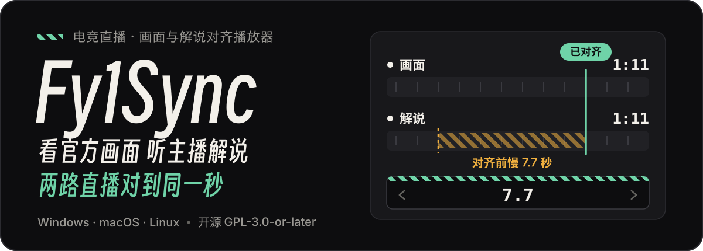
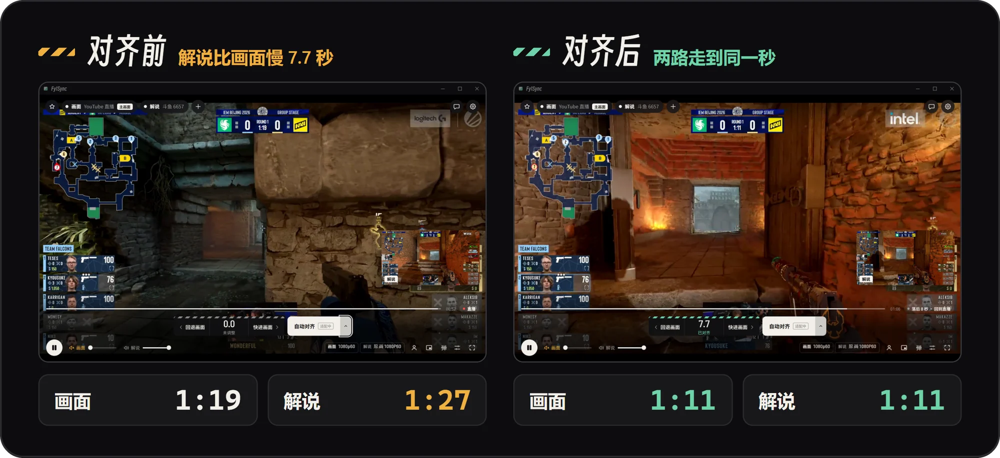
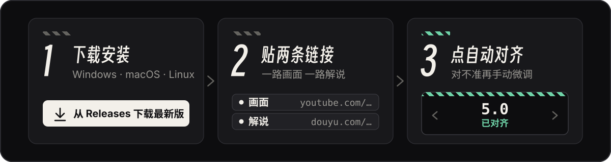
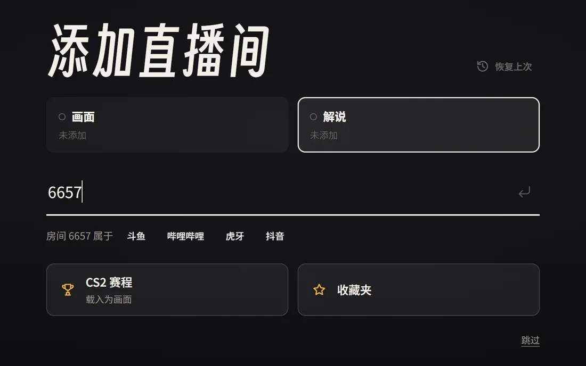
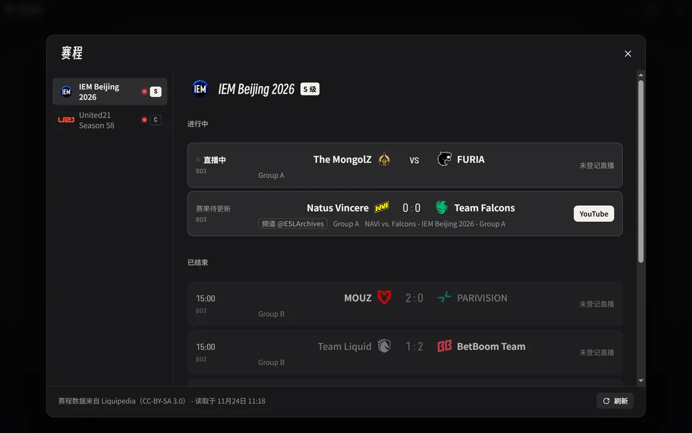
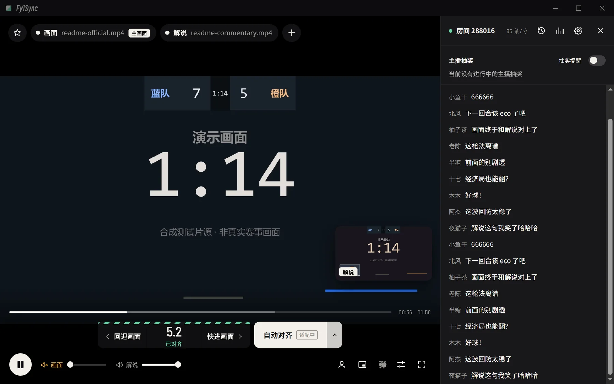
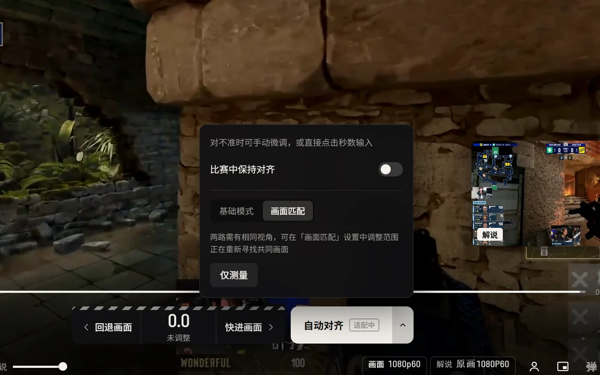
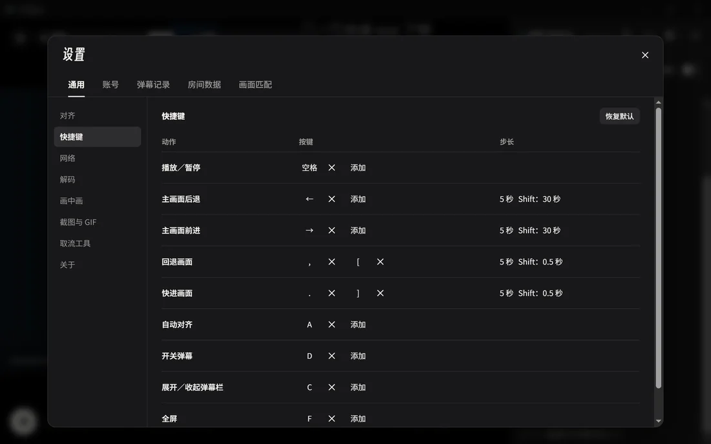
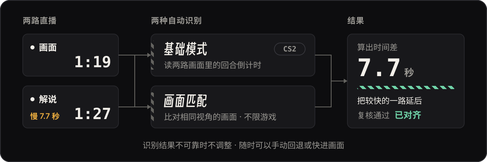
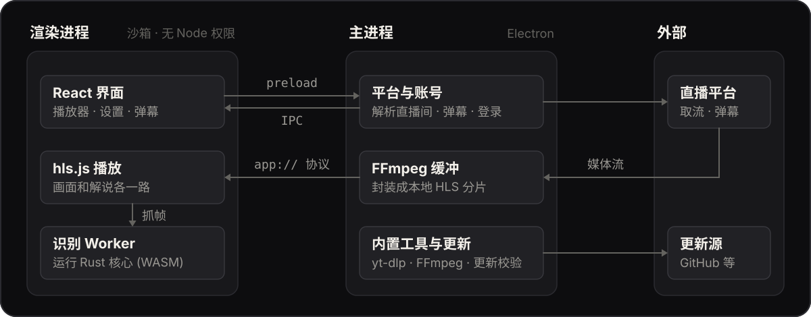

<p align="center">
  
</p>

<p align="center">
  给电竞观众用的桌面播放器: 一边放官方比赛画面, 一边放你喜欢的主播解说,<br>
  自动算出两路直播差了几秒, 把快的那一路延后, 让画面, 解说和弹幕落在同一时刻.
</p>

<p align="center">
  <a href="https://github.com/Fy1ng/Fy1Sync/releases/download/v0.5.1/Fy1Sync-0.5.1-win-x64-nsis.exe"></a>
  <a href="https://gitcode.com/Fy1ng/Fy1Sync/releases/download/v0.5.1/Fy1Sync-0.5.1-win-x64-nsis.exe"></a>
  <a href="https://github.com/Fy1ng/Fy1Sync/releases/download/v0.5.1/Fy1Sync-0.5.1-win-x64-portable.zip"></a><br>
  <a href="https://github.com/Fy1ng/Fy1Sync/releases/download/v0.5.1/Fy1Sync-0.5.1-mac-arm64.dmg"></a>
  <a href="https://github.com/Fy1ng/Fy1Sync/releases/download/v0.5.1/Fy1Sync-0.5.1-mac-x64.dmg"></a>
  <a href="https://github.com/Fy1ng/Fy1Sync/releases/download/v0.5.1/Fy1Sync-0.5.1-linux-x64.deb"></a>
  <a href="https://github.com/Fy1ng/Fy1Sync/releases/download/v0.5.1/Fy1Sync-0.5.1-linux-x64.AppImage"></a>
  <a href="https://gitcode.com/Fy1ng/Fy1Sync/releases"></a>
</p>

<p align="center">
  <a href="https://github.com/Fy1ng/Fy1Sync/releases/latest"></a>
  <a href="https://github.com/Fy1ng/Fy1Sync/releases"></a>
  <a href="https://github.com/Fy1ng/Fy1Sync/releases"></a>
  <a href="LICENSE"></a>
</p>

<p align="center">
  Windows · macOS · Linux　|　斗鱼 · 哔哩哔哩 · 虎牙 · 抖音 · YouTube · Twitch<br>
  积极开发中, 目前是 0.x 版本　|　画面匹配支持同视角直播, CS2 另可识别回合倒计时
</p>

<p align="center">
  <a href="#三步开始">三步开始</a> ·
  <a href="#能做什么">能做什么</a> ·
  <a href="#支持的平台">支持的平台</a> ·
  <a href="#不适合的情况">不适合的情况</a> ·
  <a href="#常见问题">常见问题</a> ·
  <a href="#给开发者">给开发者</a>
</p>

<p align="center">
  
</p>

## 这是什么

看比赛时, 很多人习惯开着官方直播的画面, 再听自己喜欢的主播解说. 麻烦在于两路直播的延迟不一样: 解说已经在喊, 你这边的画面还没开枪; 或者画面先出了结果, 解说晚几秒才到.

Fy1Sync 把这两路直播放进同一个播放器:

- **画面** 一路, **解说** 一路, 可以来自不同平台, 音量各自调, 有多个画质档位时清晰度也各自选.
- 点一下 **自动对齐**, 应用会算出两路差了几秒, 把快的那一路延后. 识别结果不可靠时它不会乱调, 你也可以随时手动微调.
- 默认显示解说所在直播间的弹幕, 飘在画面上或放在侧栏, 并且跟着解说的播放时间走.

自动对齐支持比对两路相同视角的画面 (不限游戏), CS2 还可以直接读画面顶部的回合倒计时; 机位不同时也可以手动对齐. 它只负责"看", 不是推流或开播工具.

## 和手动对时间相比

不装任何东西也能做到类似的事: 开两个浏览器标签页, 把其中一个暂停几秒. 两种做法的差别:

| | 两个标签页手动暂停 | Fy1Sync |
| --- | --- | --- |
| 时间差怎么得到 | 凭感觉试 | 从两路画面里读回合倒计时, 或比对两路画面, 算出秒数 |
| 调整精度 | 取决于手速 | 默认步长 5 秒或 0.5 秒, 也可直接输入秒数 (到 0.01 秒) |
| 直播卡顿或重连之后 | 重新试 | 检测到可能错开时会提示, 可一键重新对齐, 或开启定时复查 |
| 弹幕 | 跟着各自的网页, 和延后的解说对不上 | 跟着解说的播放时间显示 |
| 安装成本 | 无 | 要装一个应用 (Windows 安装包约 190 MB) |
| 适用内容 | 网页能播的都行, 包括点播 | 六个直播平台正在进行的直播, 以及媒体直链 |

如果你只是偶尔看一场, 或者要看的是点播回放, 手动暂停就够了.

## 三步开始

<p align="center">
  
</p>

### 1. 下载安装

到 [Releases 页面](https://github.com/Fy1ng/Fy1Sync/releases/latest) 按系统选一个文件 (文件名前面都带 `Fy1Sync-版本号-`):

| 系统 | 推荐下载 | 免安装的选择 |
| --- | --- | --- |
| Windows (x64) | `win-x64-nsis.exe` | `win-x64-portable.zip` |
| macOS 13 及以上, Apple 芯片 | `mac-arm64.dmg` | `mac-arm64.zip` |
| macOS 13 及以上, Intel | `mac-x64.dmg` | `mac-x64.zip` |
| Linux x64 | `linux-x64.deb` | `linux-x64.AppImage`, `linux-x64.tar.gz` |
| Linux arm64 | `linux-arm64.deb` | `linux-arm64.AppImage`, `linux-arm64.tar.gz` |

播放要用到的 FFmpeg 和 yt-dlp 已经打在安装包里, 不用自己装. GitHub 发布页底部文件超过 10 个会默认折叠 Windows 安装包, 直接点页面顶部的下载按钮即可; 国内访问 GitHub 较慢时, 直接点上方的国内下载按钮或前往 [GitCode 镜像](https://gitcode.com/Fy1ng/Fy1Sync/releases).

**第一次打开时系统可能会拦一下.** 安装包目前未配置付费证书签名与公证, 这是正常现象:

- **Windows**: 出现 SmartScreen 提示时, 点 **更多信息**, 再点 **仍要运行**.
- **macOS**: 先将 `Fy1Sync.app` 拖入 **应用程序 (`Applications`)** 文件夹 (不要在 `.dmg` 挂载窗口内直接打开; 下载 `.zip` 也请先解压并拖入 `Applications`). 首次打开若提示 **“Fy1Sync”已损坏, 无法打开** (未购买苹果付费证书导致的系统默认拦截, `.dmg` 和 `.zip` 均只需首次处理一次), 打开 **终端 (`Terminal`)** 执行 `xattr -cr /Applications/Fy1Sync.app` 后再打开即可 (若放在其他位置, 输入 `xattr -cr ` 加空格后将应用拖入终端回车; `v0.5.0` 及更早旧版需额外执行 `codesign --force --deep --sign - /Applications/Fy1Sync.app`); 若提示无法验证开发者, 到 **系统设置 → 隐私与安全性** 点击 **仍要打开**.
- **Linux**: 构建基线是 Ubuntu 22.04 (glibc 2.35), 需要桌面图形环境. AppImage 可能需要 FUSE 2, 也可以加 `--appimage-extract-and-run` 运行, 或改用 `tar.gz`.

每个版本都附带 `SHA256SUMS.txt`, 可以用它核对下载的文件.

### 2. 添加画面和解说

打开应用会看到 **添加直播间**:

1. 选 **画面**, 粘贴比赛官方直播的链接, 按回车.
2. 选 **解说**, 粘贴主播直播间的链接, 按回车. 只知道数字房间号也行: 输入数字, 先点一下它属于哪个平台, 再按回车.

添加完画面后这个界面如果自动收起了, 点播放器顶部的 **解说** 继续添加就行.

不想找链接的话, 点 **CS2 赛程**, 从正在进行的比赛里一键选择官方直播载入为画面 (赛程直播来自 YouTube / Twitch, 国内网络需开启系统代理; 不开代理时可直接粘贴虎牙, 哔哩哔哩, 斗鱼或抖音的赛事官方直播间).

<p align="center">
  
  
</p>

### 3. 对齐

两路都播起来之后, 用底栏中间的 **自动对齐** (按钮显示 **准备中** 说明还在缓冲, 稍等一下):

- 等两边都在播同一回合, 画面上的回合倒计时在正常走, 点 **自动对齐** (默认快捷键 `A`).
- 中间的读数显示 **已对齐** 就完成了.
- 没对上? 用 **回退画面** 和 **回退解说** 手动调, 默认每点一次 5 秒, 按住 `Shift` 再点是 0.5 秒. 哪边快了就延后哪边, 也可以点中间的秒数直接输入.

## 能做什么

<p align="center">
  
</p>

**看**

- 画面和解说各一路, 小画面可以随时切换成主画面, 也可以隐藏.
- **同屏观看** 更多直播间: 应用内的悬浮窗, 以及左右分屏, 上下分屏和自定义比例.
- **画中画**: 系统画中画不带弹幕; 增强画中画是应用自己的小窗, 可以带弹幕.
- **框选主播摄像头**: 从解说画面里裁出主播的摄像头单独显示.
- 截图和 GIF 录制 (默认关闭, 在 **设置 → 通用 → 截图与 GIF** 里打开).

**对齐**

- 自动对齐有 **基础模式** 和 **画面匹配** 两种识别方式, 见 [对齐是怎么做到的](#对齐是怎么做到的).
- **仅测量**: 只告诉你差了几秒, 不动播放.
- **比赛中保持对齐**: 打开后每隔 15 秒, 30 秒, 1 分钟或 2 分钟自动复查一次.
- 手动回退, 快进, 或者直接输入秒数.

**弹幕**

- 斗鱼, 虎牙, 抖音和哔哩哔哩 的弹幕可以飘在画面上, 也可以放在侧栏.
- 可以调样式, 过滤, 屏蔽用户.
- 抽奖, 福袋这类房间活动会显示成卡片, 可以开启提醒.

**找比赛, 记直播间**

- **CS2 赛程**: 按赛事看进行中, 即将开始和已结束的比赛 (数据来自 Liquipedia).
- **收藏**: 收藏常看的直播间, 一键载入为画面或解说. 独立的收藏夹页面可以搜索, 看谁在播.
- **恢复上次**: 一键读回上次看的画面和解说.

**顺手的小事**

- 快捷键都可以在 **设置 → 通用 → 快捷键** 里改.
- 手动 **检查更新**, 更新源可选 GitHub 或 GitCode. 应用不会在后台自己检查或下载.

<p align="center">
  
  
</p>

## 支持的平台

| 平台 | 当画面或解说 | 弹幕 | 登录 |
| --- | --- | --- | --- |
| 斗鱼 | 可以 | 可以看; 发送等操作是实验功能, 默认关闭 | 可选 |
| 哔哩哔哩 | 可以 | 只能看 | 可选 |
| 虎牙 | 可以 | 只能看 | 可选 |
| 抖音 | 可以 | 可以看; 登录后可以发送文字弹幕 | 可选 |
| YouTube | 可以 (仅直播) | 暂不支持 | 可选 |
| Twitch | 可以 | 暂不支持 | 可选 |

- 两路可以来自不同平台, 比如 YouTube 的官方画面配斗鱼的解说.
- 大多数公开直播不登录就能看. 登录主要用于更高画质, 会员直播, 以及各平台的账号功能.
- 除了直播间, 也可以直接粘贴 HTTP/HTTPS 的媒体直链.
- 平台接口随时可能变化, 某个房间, 地区或画质暂时打不开是可能的. 遇到了欢迎提 [Issue](https://github.com/Fy1ng/Fy1Sync/issues).

## 对齐是怎么做到的

<p align="center">
  
</p>

两路直播里其实有同一个"时钟", 只要找到它, 就能算出两边差了多少:

- **基础模式** 读画面里的回合倒计时. 两路要在播同一回合, 目前针对 CS2 的正式回合倒计时, 还在继续适配.
- **画面匹配** 不看倒计时, 直接比对两路画面本身. 两路需要有相同视角的画面 (比如解说转播的就是官方画面); 如果解说画面被摄像头或贴图挡住了一部分, 可以在 **设置 → 画面匹配** 里裁剪范围或加忽略区域.

算出时间差后, 应用把较快的一路延后, 再用新的画面复核一遍, 通过才显示 **已对齐**. 识别不稳, 或者找到多个相似片段时, 它不会调整, 并告诉你原因.

另外两点: 一路直播也能单独看, 但对齐需要两路; 手动调整之后, 自动对齐会暂停, 再点一次 **自动对齐** 恢复. 其他限制见 [不适合的情况](#不适合的情况).

默认快捷键 (可以在设置里改):

| 动作 | 按键 |
| --- | --- |
| 自动对齐 | `A` |
| 回退画面 / 回退解说 | `,` 或 `[` / `.` 或 `]` (按住 `Shift` 为 0.5 秒) |
| 播放／暂停 | `空格` |
| 主画面后退 / 前进 | `←` / `→` (5 秒, 按住 `Shift` 为 30 秒) |
| 开关弹幕 | `D` |
| 展开／收起弹幕栏 | `C` |
| 全屏 | `F` |

## 不适合的情况

- **点播, 回放和本地视频文件**: 直播平台只支持正在进行的直播, 不支持 YouTube 点播和直播回放, 也不提供打开本地视频文件的入口.
- **机位完全不同时想全自动**: 画面匹配不限游戏, 但要求两路有相同视角的画面 (例如解说转播的就是官方画面); 倒计时识别目前只适配 CS2. 机位完全不同或只有声音相同时只能手动对齐.
- **两路差得太多**: 偏移最多 60 秒, 实际还取决于已经缓冲了多久.
- **想看到最快的直播**: 对齐靠的是把较快的一路延后, 对齐后你看到的内容会比它晚几秒.
- **想看 YouTube 或 Twitch 的聊天**: 暂时不显示.
- **想要自动更新**: 应用不会自动检查更新. 在应用里升级完整版本只支持 Windows 安装版; 便携版, macOS 和 Linux 需要到发布页下载新版本.

## 常见问题

<details>
<summary>需要开启代理吗? 官方高清比赛流去哪找?</summary>

<br>

- **国内平台免代理**: 虎牙, 哔哩哔哩, 斗鱼, 抖音的赛事官方直播间与主播直播间均直接连接, 不需要代理.
- **海外官方流需代理**: **CS2 赛程** 一键载入的直播以及手动粘贴的 YouTube, Twitch 链接, 在国内网络下需要开启系统代理 (**设置 → 通用 → 网络** 默认按平台分流, 开启代理时国内平台仍保持直连).

</details>

<details>
<summary>一定要登录吗?</summary>

<br>

不用. 大多数公开直播可以直接看, 也可以直接对齐. 不登录时, 斗鱼, 哔哩哔哩, 虎牙, Twitch 等平台可能拿不到原画或最高画质; 直播间遇到画质受限或验证提示时, 直接点提示旁的 **登录** 按钮即可, 也可前往 **设置 → 账号**.

</details>

<details>
<summary>自动对齐一直失败怎么办?</summary>

<br>

先看提示说的是什么:

- 提示没读到倒计时, 或倒计时不稳定: 等两边都进入同一回合, 倒计时连续走几秒后再试. 回放镜头里, 或者比赛暂停倒计时不走的时候, 通常识别不出来.
- 提示尚未找到共同画面: 画面匹配需要先播放一小段来积累画面, 等一会儿再点. 一直找不到的话, 可能是两路的视角本来就不一样.
- 提示两路相差超过 60 秒: 超出了可调范围, 可以重新载入其中一路后再试.

都不行的话直接手动调: 盯住一个明显的瞬间 (比如回合结束), 用 **回退画面** 和 **回退解说** 调到一致.

</details>

<details>
<summary>画面花屏, 绿屏或黑屏?</summary>

<br>

到 **设置 → 通用 → 解码** 打开 **软件解码**, 重启应用后生效.

</details>

<details>
<summary>某个直播间打不开?</summary>

<br>

先确认它正在直播, 并且在浏览器里能正常观看. 会员专享的直播需要先登录对应平台; 有地区限制的直播取决于你的网络. 仍然不行的话, 到 **设置 → 通用 → 取流工具** 里 **导出诊断报告**, 附在 [Issue](https://github.com/Fy1ng/Fy1Sync/issues) 里. 报告只保存到你的电脑, 不会自动上传.

</details>

<details>
<summary>怎么更新?</summary>

<br>

**设置 → 通用 → 关于 → 检查更新**. Windows 安装版可以在应用里升级, 其他情况请到发布页下载新版本.

另外, **设置 → 通用 → 取流工具** 里可以单独更新 yt-dlp. YouTube 突然打不开时可以先试这个.

</details>

## 隐私与数据

- 应用没有接入自己的统计或崩溃上报. 诊断报告只在你手动导出时生成, 并且只保存在本机.
- 登录信息只保存在你的电脑上, 应用只把它发给对应的平台. 需要知道的是: 各平台的登录 Cookie 以明文文件保存在应用数据目录里, 所以不要把这个目录发给别人.
- 应用会直接连接你观看的直播平台. 登录斗鱼并观看斗鱼直播间时, 应用会按平台的规则向斗鱼上报观看时长, 用于平台自己的观时统计.
- 斗鱼的发送弹幕, 送礼, 签到任务这些主动操作账号的功能是实验性的, 默认关闭, 需要你在 **设置 → 账号 → 斗鱼 → 实验性** 里手动打开.
- Windows 安装版正常卸载时, 会保留你的设置和登录信息.
- CS2 赛程和队标经由项目维护者运行的中转服务器 `schedule.fy1ng.cn` 获取, 该服务器不记录访问日志.

---

## 给开发者

Fy1Sync 是一个 Electron 应用: 界面用 React 和 TypeScript, 倒计时识别的核心用 Rust 写成, 编译为 WebAssembly 在 Worker 里运行. 采用 [GPL-3.0-or-later](LICENSE) 许可.

| | |
| --- | --- |
| 桌面外壳 | Electron 44 |
| 界面 | React 19, TypeScript 6, Vite 8 |
| 播放 | hls.js, 由主进程用 FFmpeg 把直播流封装成本地 HLS 缓冲 |
| 识别核心 | Rust → WebAssembly (wasm-bindgen 0.2.105) |
| 取流工具 | 内置 FFmpeg / ffprobe 和 yt-dlp |
| 测试 | Vitest, Playwright (驱动真实 Electron 窗口), cargo test |

### 结构

<p align="center">
  
</p>

- **渲染进程** 开启沙箱和上下文隔离, 没有 Node 权限, 只能通过 preload 暴露的白名单接口发起 IPC 调用.
- **主进程** 负责解析直播间, 管理账号和弹幕连接. 直播流经 FFmpeg 封装成本地 HLS 分片, 再通过应用自己的 `app://` 协议交给 hls.js 播放.
- **识别** 在渲染进程抓帧, 交给 Worker 里的 WASM 模块读倒计时; 画面匹配另有独立的 Worker.

| 目录 | 内容 |
| --- | --- |
| `src/` | React 界面, 会话状态, 播放, 对齐, 弹幕, Worker 与 WASM 加载 |
| `electron/` | 主进程: 窗口, preload 和 IPC, 安全边界, 账号, 缓冲, 更新 |
| `server/` | 主进程调用的平台解析, 网络, 弹幕和赛程模块 (不是独立服务) |
| `relay/` | CS2 赛程与队标缓存中转服务 |
| `crates/` | Rust 识别核心, WASM 接口, 离线 CLI, Windows 浏览器凭据助手 |
| `e2e/` | Playwright 驱动 Electron 的端到端场景 |
| `scripts/` | 构建, 打包, 测试素材和发布检查脚本 |
| `packaging/` | 安装器资源, 工具版本锁, 第三方声明, 版本说明 |

### 从源码运行

需要:

- Node.js 22.12 或更高 (CI 使用 24.15.0)
- Rust 工具链, 并添加 WebAssembly 目标

```bash
rustup target add wasm32-unknown-unknown
git clone https://github.com/Fy1ng/Fy1Sync.git
cd Fy1Sync
npm ci
npm run dev
```

`npm run dev` 会先构建 WASM 和主进程, 再启动 Electron. 本地还没有指定版本的 `wasm-bindgen-cli` 时, 会先用 cargo 安装一次, 要多等一会儿.

开发模式不带内置工具. 要播放真实直播, 需要自己准备 FFmpeg 和 ffprobe (YouTube 还需要 yt-dlp), 放进 `PATH`, 或者用环境变量 `STREAM_SYNC_FFMPEG`, `STREAM_SYNC_FFPROBE`, `STREAM_SYNC_YTDLP` 指定绝对路径.

### 常用命令

| 命令 | 作用 |
| --- | --- |
| `npm run dev` | 开发模式, 监听前端改动 |
| `npm run build` | 完整构建: WASM, 类型检查, 前端, 主进程 |
| `npm start` | 启动已经构建好的应用 |
| `npm test` | 单元测试 (Vitest) |
| `npm run test:e2e` | 端到端测试 (Playwright + Electron), 需要先 `npm run build` |
| `npm run typecheck` | 前端, 主进程, E2E 三套类型检查 |
| `npm run fixtures` | 生成合成测试片源, 需要完整版 FFmpeg |
| `npm run package:win` / `package:mac` / `package:linux` | 在对应系统上打安装包 |

### 测试

- 358 个单元测试文件 (`src/`, `server/`, `electron/`, `relay/`), 用 Vitest 运行.
- 69 个端到端场景文件, 由 Playwright 驱动真实的 Electron 窗口. 默认完全离线, 每次运行使用独立的临时数据目录, 不会碰你的真实账号和设置.
- Rust 核心用 `cargo test --workspace --locked`.
- 识别相关的测试素材由脚本合成, 不随仓库提交. 跑完整的端到端测试前先执行 `npm run fixtures`, 否则一部分场景会跳过, 一部分会失败.

### 发布

推送 `v<版本号>` 标签会触发 [发布流程](.github/workflows/release.yml): 在 Windows, macOS (Intel 和 Apple 芯片) 和 Linux (x64 和 arm64) 的原生环境里各自构建, 启动检查通过后, 把 12 个安装包和免安装包, 连同 `SHA256SUMS.txt`, 发布到 GitHub Releases. 每个版本的说明在 [`packaging/releases/`](packaging/releases).

### 参与

发现问题或有想法, 欢迎提 [Issue](https://github.com/Fy1ng/Fy1Sync/issues). 提交代码前请先跑一遍 `npm run typecheck` 和 `npm test`.

## 许可

Fy1Sync 以 [GPL-3.0-or-later](LICENSE) 发布. 随包分发的 FFmpeg, yt-dlp 等第三方组件各有自己的许可, 见 [第三方声明](packaging/THIRD-PARTY-NOTICES.md).

CS2 赛程信息来自 [Liquipedia](https://liquipedia.net/counterstrike/Liquipedia:Matches), 按 [CC BY-SA 3.0](https://creativecommons.org/licenses/by-sa/3.0/) 使用. 战队名称与队标的权利属于各自权利人.
